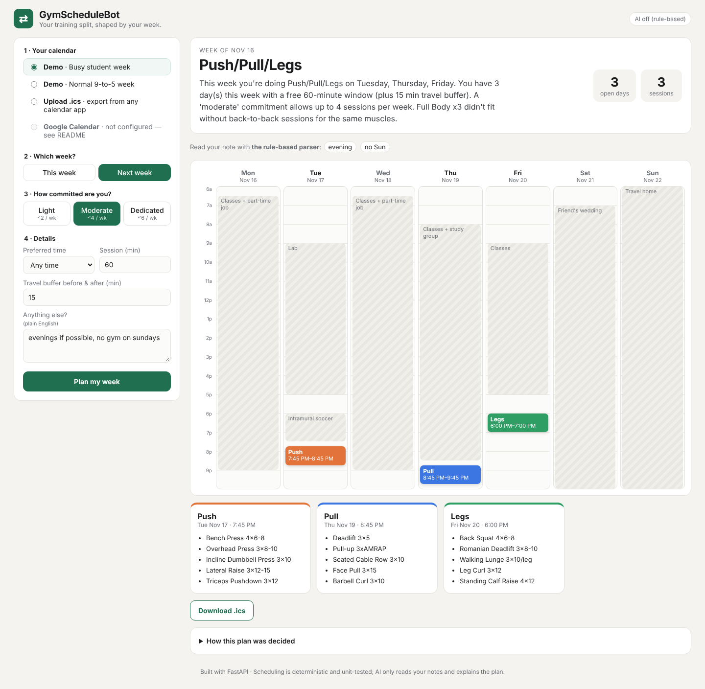

# GymScheduleBot

**A workout planner that reads your calendar and changes your training split based on how busy your week is.**

Most people don't skip the gym because they're lazy. They skip because their week got busy and their plan didn't change with it. GymScheduleBot looks at when you're actually free, then picks a split you can finish:

| Free days (after your commitment cap) | Split |
|---|---|
| 1 | Full Body ×1 |
| 2 | Full Body ×2 (or Upper/Lower if the days are back-to-back) |
| 3 | Full Body ×3 (or Push/Pull/Legs if days are consecutive) |
| 4 | Upper/Lower ×2 |
| 5 | Push/Pull/Legs + Upper/Lower |
| 6 | Push/Pull/Legs ×2 |

A busy person automatically gets two full-body days. A dedicated lifter with an open week gets PPL ×2.



## Features

- **Calendar input:** Google Calendar (OAuth, reads **free/busy only**, never event details), `.ics` upload from any calendar app, or built-in demo weeks so anyone can try it without signing in.
- **Plain-English preferences:** "I hate mornings, soccer on Tuesdays 6–7:30pm, no gym on Sundays" becomes structured settings. Uses Gemini when an API key is set, otherwise a rule-based parser.
- **Recovery-aware scheduling:** never trains the same muscle group on back-to-back days, and spreads sessions evenly across the week.
- **Respects real life:** travel buffer before and after every event, earliest/latest workout times, preferred time of day, and no times that have already passed.
- **Export:** one click to add workouts to Google Calendar, or download an `.ics`.
- **Explains itself:** every plan shows why that split was chosen.

## How it works

```
 calendar source ──► busy blocks ──► free slots ──► choose split ──► place sessions ──► weekly plan
 (Google / .ics /                    (availability.py) (splits.py)    (planner.py)          │
  demo)                                                                                     ▼
 plain-English note ──► AI / rule parser ──► preferences                         AI explanation, .ics,
                         (assistant.py)                                          Google Calendar events
```

**Design decision: AI translates, code decides.** The language model only turns free text into structured preferences and turns the planner's reasons into a short summary. Every scheduling decision is made by deterministic, unit-tested Python. That makes plans predictable and testable, keeps API costs tiny, and lets the whole app work with no API key.

### The scheduling algorithm

1. **Free slots** (`app/scheduler/availability.py`): for each day, pad every busy block with the travel buffer, clip to the allowed window, sort and merge overlapping intervals, and keep the gaps long enough for a session. O(B log B) per day.
2. **Session target:** `min(commitment cap, days with a free slot)`. The caps are Light 2, Moderate 4, Dedicated 6.
3. **Placement** (`app/scheduler/planner.py`): for each candidate split, try every way of placing its sessions on the free days (at most C(7,k) ≤ 35 options), reject placements that train the same muscle group on consecutive days, and score the rest by:
   - **spacing:** variance of the gaps between sessions, including the wrap-around to next week, so Mon/Thu beats Mon/Tue
   - **time preference:** hours away from the preferred time of day
4. **Fallback:** if no split fits, drop one session and try again. For example, with only Wed/Thu/Fri free, Full Body ×3 can't avoid back-to-back days, so the planner switches to Push/Pull/Legs.

## Tech stack

Python 3.11+ · FastAPI · Jinja2 · Google Calendar API (OAuth 2.0 with PKCE) · Google Gemini API (structured JSON output) · icalendar · pytest · ruff · GitHub Actions

## Run it locally

```bash
git clone https://github.com/<your-username>/GymScheduleBot.git
cd GymScheduleBot
python -m venv .venv && source .venv/bin/activate   # Windows: .venv\Scripts\activate
pip install -r requirements-dev.txt
cp .env.example .env          # optional: works with no keys at all
uvicorn app.main:app --reload
```

Open http://localhost:8000 and try the **Busy student week** demo.

Run the tests and linter:

```bash
pytest -q
ruff check . && ruff format --check .
```

### Optional: turn on AI

Add `GEMINI_API_KEY=...` to `.env` (get a free key at https://aistudio.google.com/apikey). The model is set by `GEMINI_MODEL`. Note: on Gemini's free tier, Google may use requests to improve its products, so the app only ever sends your plain-English note and the plan summary, never calendar data.

### Optional: connect Google Calendar

1. In [Google Cloud Console](https://console.cloud.google.com/), create a project and **enable the Google Calendar API**.
2. **OAuth consent screen:** choose External, add the scopes `calendar.freebusy` and `calendar.events`, and add your own Google account as a **test user**.
3. **Credentials → Create OAuth client ID → Web application.** Add an authorized redirect URI for each place the app runs, e.g. `http://localhost:8000/auth/google/callback` and `https://<your-app>.onrender.com/auth/google/callback`.
4. Locally: put the client ID and secret into `.env` as `GOOGLE_CLIENT_ID` and `GOOGLE_CLIENT_SECRET`, then restart the server.
   Deployed: set `GOOGLE_CLIENT_ID`, `GOOGLE_CLIENT_SECRET` and `GOOGLE_REDIRECT_URI` (the deployed callback URL) as environment variables. Don't set `OAUTHLIB_INSECURE_TRANSPORT` there.

While the app is in Google's "Testing" mode, only the test users you add can sign in (up to 100), and their sign-in lasts 7 days. That's why the demo calendars exist: anyone can try the planner without Google.

## Project structure

```
app/
  main.py                 FastAPI routes + calendar view model
  models.py               shared data types
  scheduler/
    availability.py       busy blocks -> free slots
    splits.py             split definitions + choice rules
    planner.py            recovery-aware placement + fallback
  sources/
    google_calendar.py    OAuth, free/busy, add events
    ics.py                .ics import (incl. recurring events) and export
    demo.py               sample weeks
  ai/assistant.py         Gemini structured-output parsing + explanations, rule-based fallback
  templates/, static/     UI
tests/                    unit + integration tests
```

## Roadmap

- [ ] **"I missed a session":** re-plan the rest of the week from today
- [ ] **Carry recovery across weeks:** last week's Sunday legs should affect this Monday
- [ ] **Progress tracking:** log sets and weights, with progressive overload suggestions
- [ ] **Store users in a database:** SQLite or Postgres instead of cookie sessions
- [ ] **Weekly auto-planning:** a Sunday-night job that adds next week's plan automatically
- [ ] **Deploy:** for example, Render or Fly.io (`uvicorn app.main:app --host 0.0.0.0 --port $PORT`)

## Security notes

- Reads only free/busy data from Google, never event titles or descriptions.
- OAuth uses `state` and PKCE. The user's own tokens live in a signed session cookie (fine for a demo; a production version would store them encrypted server-side). The app's client secret never leaves the server.
- Secrets come from environment variables, and `.env` is git-ignored.

## License

MIT
